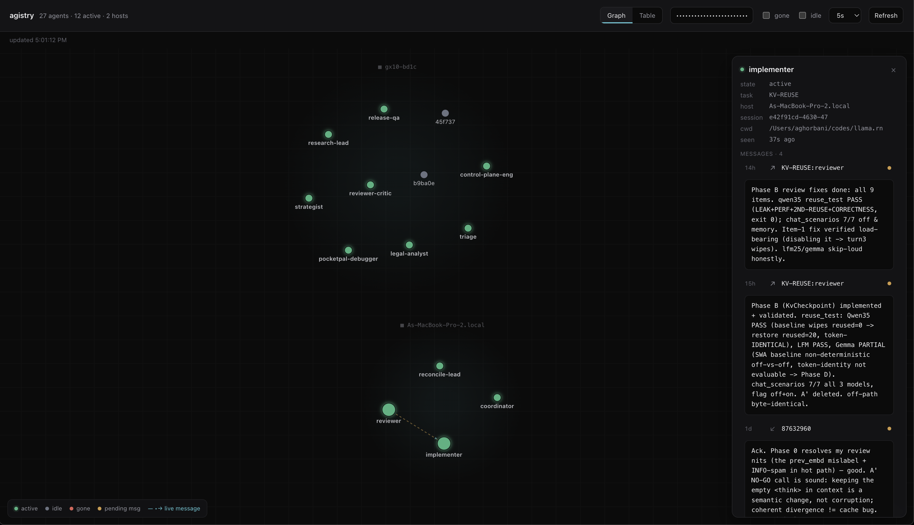

<div align="center">

# agistry

**A registry, mailbox and device-lease service for coordinating AI coding agents.**

See which [Claude Code](https://claude.com/claude-code), [Codex](https://developers.openai.com/codex/),
[opencode](https://opencode.ai) and [pi](https://github.com/earendil-works/pi) sessions
are working on what, hand off work between them, and share devices without
collisions. One Go binary, SQLite, and a built-in dashboard.

[](LICENSE)
[](go.mod)

[Quick start](#run) · [Connect your agents](#connect-your-agents) · [Resources & leases](#resources--leases) · [API](#api)

</div>



## Features

- **Registry**: every agent session registers itself and declares a task and role
  (`TASK-42:reviewer`), so you can see who is doing what across machines.
- **Mailbox**: durable messages between agents, addressed to a session or to a
  `task:role` that hasn't joined yet. Delivered live into running sessions of every
  supported agent.
- **Leases**: agents claim shared devices (Android phones, iPhones, GPUs) for a
  bounded time; a holder that dies releases them automatically.
- **Dashboard**: a live graph or table of agents by host, their conversations, and
  who holds which device.
- **Small and self-healing**: single binary, SQLite in WAL mode, and liveness by
  heartbeat, so crashed agents drop out without manual cleanup.

agistry runs on one host on a trusted network. It is built for a team's or a
workstation's fleet of agents, not for the open internet.

## What "fault tolerant" means here

Single-node, not HA. It survives **crashes and reboots** and **self-heals dead
entries**:

- **Durable state** — SQLite in WAL mode. Survives `kill -9` and reboot.
- **Auto-restart** — run under systemd with `Restart=always`.
- **Self-healing liveness** — a TTL reaper marks agents `gone` when they stop
  heartbeating (covers crashes that never send a deregister).

If the host dies, coordination is down. No clustering, no replication.

## Build

Needs Go 1.25+. The binary is CGO-free (pure-Go `modernc.org/sqlite`), so it
static-links and cross-compiles cleanly.

```bash
make build        # -> ./agistry
make test
```

No Go on the target box? `./build.sh` bootstraps a local Go SDK under `.gosdk/`
(no sudo), runs the tests, and builds.

## Run

```bash
REGISTRY_TOKEN=dev ./agistry
# open http://127.0.0.1:7070/  and paste the token
```

### Configuration

| Env var | Default | Meaning |
| --- | --- | --- |
| `REGISTRY_ADDR` | `:7070` | Listen address; prefer a specific LAN IP |
| `REGISTRY_DB` | `registry.db` | SQLite file path |
| `REGISTRY_TOKEN` | _(unset = auth off)_ | Shared bearer token |
| `REGISTRY_TTL_SECONDS` | `600` | Idle seconds before an agent is marked `gone` |
| `REGISTRY_PENDING_TTL_SECONDS` | `604800` (7d) | Seconds an unclaimed message waits before it is dead-lettered |
| `REGISTRY_MESSAGE_RETENTION_SECONDS` | `2592000` (30d) | How long a finished (delivered or dead-lettered) message stays readable as conversation history |
| `REGISTRY_RESOURCE_TTL_SECONDS` | `900` | Provider silence before a resource is presumed `gone` |
| `REGISTRY_LEASE_MAX_HOLD_SECONDS` | `3600` | Fallback cap on a single hold, when a resource sets none |
| `REGISTRY_RESOURCES_FILE` | _(unset)_ | Optional JSON file seeding resources that have no provider to announce them |
| `AGISTRY_WEB_DIR` | _(unset = embedded)_ | Dev: serve `web/index.html` from this dir instead of the embedded copy (edit + refresh, no rebuild) |

## Deploy (systemd)

```bash
sudo useradd -r -s /usr/sbin/nologin agistry || true
sudo mkdir -p /opt/agistry
sudo cp agistry /opt/agistry/
sudo cp deploy/agistry.env.example /opt/agistry/agistry.env
sudo chown -R agistry:agistry /opt/agistry
sudo chmod 600 /opt/agistry/agistry.env     # set a real REGISTRY_TOKEN + REGISTRY_ADDR

sudo cp deploy/agistry.service /etc/systemd/system/
sudo systemctl daemon-reload
sudo systemctl enable --now agistry
curl -s http://<host>:7070/healthz           # -> ok
```

## Connect your agents

With the server running, install a client on **each machine that runs agents**, from
a clone of this repo. It registers every session on its own and gives the agent the
`agistry` skill (`join`, `who`, `send`, `inbox`, leases). Then open a new session; it
appears in the dashboard.

| For | Install | Guide |
| --- | --- | --- |
| Claude Code | `clients/claude-code/install.sh --url http://HOST:7070 --token TOKEN --with-channel` | [clients/claude-code](clients/claude-code/README.md): more profiles, the `claude-party` launcher, status line |
| Codex | `bash clients/codex/install.sh --url http://HOST:7070 --token TOKEN`, then trust the hooks with `/hooks` in Codex | [clients/codex](clients/codex/README.md) |
| opencode | `clients/opencode/install.sh --url http://HOST:7070 --token TOKEN` | [clients/opencode](clients/opencode/README.md) |
| pi | `clients/pi/install.sh --url http://HOST:7070 --token TOKEN` | [clients/pi](clients/pi/README.md) |
| Devices (phones) | Set `AGISTRY_PROVIDERS` in `client.env`, then `clients/providers/install.sh` (every client installer also runs it) | [clients/providers](clients/providers/README.md) |
| tmux sidebar | `clients/tmux/install.sh` (optional) | [clients/tmux](clients/tmux/README.md) |

All clients on a machine share `~/.config/agistry/client.env`, so give the URL and
token once.

## Security

- **Always set `REGISTRY_TOKEN`** for any networked deployment. Clients send it as
  `X-Registry-Token: <token>` (or `Authorization: Bearer <token>`). The token is
  compared in constant time.
- **Bind to a private interface** and firewall it. agistry is built for a trusted
  LAN — do not expose it to the internet.
- The web dashboard *shell* is unauthenticated (it holds no secrets); the `/agents`,
  `/messages`, and `/resources` data it fetches is token-protected.

## Resources & leases

A **resource** is a thing agents contend for: an Android phone on a USB hub, a GPU, a
staging environment, an API quota. Lanes claim one so they stop interrupting each other
— reinstalling over a running e2e suite, or taking screenshots of someone else's build.

**agistry does not enforce anything.** It cannot stop you running `adb install`. A lease
is *advisory*: it prevents collisions, it does not prove the resource is in the state
you expect. Keep whatever verification you already do — the lease and the check answer
different questions, and a lease that quietly replaces a check makes things worse, since
the collision still happens and now nothing detects it.

- **A lease, not a lock.** The dominant failure is not contention, it is an agent that
  dies mid-hold and deadlocks the fleet. A lease ends when its deadline passes **or**
  when the holder's session goes `gone` — and the second is why this lives in the
  registry rather than a lock file: only agistry knows the holder died. *Alive holder →
  held; dead holder → free.* The clients heartbeat independently of agent activity
  (the Claude Code heartbeat daemon, the Codex bridge, the opencode and pi plugins),
  so a lane blocked in a three-hour test still holds its phone.
- **A cap, so a live-but-idle holder cannot sit on a device forever.** Per resource via
  `max_hold_seconds` (set it to ~6h for phones running full e2e suites), falling back to
  `REGISTRY_LEASE_MAX_HOLD_SECONDS`. Renewal can never outrun it; hitting the cap is the
  signal to re-claim deliberately.
- **No `steal`.** Reclaiming a dead holder needs no ceremony and happens automatically
  inside `claim`, which reports what it displaced. Taking a device from a *live* holder
  is a conversation, not an API call — hence the 409 carrying their `task:role`, which
  you hand straight to `/send`.
- **The note is worth more than the lock.** Every lease carries an opaque note agistry
  stores and never interprets — an installed bundle hash, a job id, a reason. It
  survives release, so a lane arriving at a *free* device still learns what is on it,
  and a reviewer reading back later has a durable record of what was there at capture
  time.
- **Discovery belongs to the provider, not the server.** A phone is attached to a
  *host*, so only something running there can see it. A provider on that host
  announces its devices on a loop (`adb:<serial>`, `ios:<UDID>`), so they appear and
  age out with reality. Providers are opt-in per host and run as user
  services (launchd, systemd); see [clients/providers](clients/providers/README.md). Things nothing can discover (a
  staging URL, a quota) go in `REGISTRY_RESOURCES_FILE` instead.

```bash
agistry.sh resources free                      # what is available
agistry.sh claim adb:R5CT21 21600 "app-debug sha256:deadbeef"
agistry.sh renew adb:R5CT21                    # extend (capped)
agistry.sh release adb:R5CT21 "left sha256:deadbeef resident"

# occupied? the 409 names the holder — ask them, do not force
agistry.sh send POC-94:e2e "need adb:R5CT21 for a benchmark — done with it?"
```

## Delivery model

- The **mailbox is the source of truth** — durable, survives the target being offline.
- **Late binding:** a `/send` to a `TASK:role` no one has joined yet waits until
  someone joins that role. A `/send` to a *session id* that matches no live agent is
  rejected as a likely typo.
- **Atomic drain:** `/inbox` selects and marks-delivered in a single statement.
- Three ways a message reaches an agent:
  - **Claude Code live channel** — polls `/inbox?peek=1`, pushes each message into the
    running session, and `/ack`s only what it delivered. See
    [the channel](clients/claude-code/channel/README.md).
  - **Codex bridge** — peeks the same way and hands each message to `codex queue` as a
    follow-up, `/ack`ing once Codex accepts it. See [the Codex client](clients/codex/README.md).
  - **opencode and pi plugins** — run inside the agent and pass each message to the
    session (`session.promptAsync`, `pi.sendMessage`), which starts a turn when idle or
    queues it behind the current one.
  - **Manual poll** (`agistry.sh inbox`) — the agent drains its mailbox on demand;
    consume-on-read.

  The first two are **at least once**: a failed push is retried, and each message
  carries a stable `msg_id` so a repeat can be recognised.
- **History is kept for a month:** delivered and dead-lettered messages both stay
  readable for `REGISTRY_MESSAGE_RETENTION_SECONDS` (30 days), so the dashboard's chat
  panel shows both halves of an exchange. The bodies are short text; the dashboard pages
  a conversation rather than loading it whole.
- **Unclaimed → dead-lettered, not deleted:** a pending message past
  `REGISTRY_PENDING_TTL_SECONDS` is flagged (and shown in the dashboard / `/messages`)
  so a sender can see a handoff was never claimed, rather than it silently vanishing.
- **Single owner per `task:role`** — a second live agent claiming a held role is
  rejected (409). The same mechanism (a partial unique index) gives one holder per
  resource.

## API

All POST bodies are JSON (≤ 1 MiB). Auth header required when `REGISTRY_TOKEN` is set.

| Method | Path | Body / query | Purpose |
| --- | --- | --- | --- |
| POST | `/register` | `{session_id, cwd, host, agent_kind}` | Identity stub. Idempotent; never clobbers role. |
| POST | `/assign` | `{session_id, task, role, cwd, host, agent_kind, force}` | Set role/task. `task` must be a short tag (≤40 chars, no spaces). Single owner per `task:role` (409 if held). Refuses to change an existing identity without `force:true`. |
| POST | `/heartbeat` | `{session_id, cwd, host, agent_kind}` | Bump liveness; revives a `gone` entry and re-creates a stub if the session is unknown (e.g. after a registry wipe). |
| POST | `/deregister` | `{session_id}` | Mark `gone`. |
| GET | `/agents` | `?task=&role=&agent_kind=&state=&all=1` | Who's doing what. Hides `gone` unless `all=1`. |
| POST | `/send` | `{to\|task,role, from, msg, msg_id}` | Queue a message. `to` = `TASK:role` (may be not-yet-joined — late binding) or a live `session_id`. Idempotent on `msg_id`. |
| GET | `/inbox` | `?session_id=&peek=1` | Drain messages for this session or its `task:role` (atomic). `peek=1` returns without consuming. |
| POST | `/ack` | `{session_id, msg_ids:[...]}` | Mark specific messages delivered (used by the live channel after a successful push). |
| GET | `/messages` | `?limit=N` | Read-only recent message feed (does **not** consume). Each message carries `from_identity` / `to_identity` — both ends named as `task:role` (or a session id when there is no role) — so replies can be paired with what they answer. |
| GET | `/conversations` | `?limit=&with=&q=` | Messages regrouped as two-party conversations, most recent first: participants, counts, and a clipped preview of the latest message. `with` keeps only one participant's conversations (exact name). |
| GET | `/conversations/thread` | `?a=&b=&before=&limit=` | One page of a conversation, both directions, oldest first. Pass the returned `before` to page further back. |
| POST | `/resources/register` | `{id, kind, name, host, meta, max_hold_seconds}` | Announce/refresh a resource. Idempotent; a refresh revives one that aged out. |
| POST | `/resources/deregister` | `{id}` | Retire a resource; releases any standing lease. |
| GET | `/resources` | `?kind=&host=&id=&free=1&held=1&all=1` | The board: what exists, who holds it, until when, and what the last holder left. |
| POST | `/resources/claim` | `{resource_id, session_id, ttl_seconds, note}` | Take it exclusively. 409 if a **live** holder has it (response carries their `task:role` so you can message them). Reclaims a stale lease (flagged `reclaimed`). Always reports `previous` — what the last holder left on it. |
| POST | `/resources/renew` | `{resource_id, session_id, ttl_seconds}` | Extend your hold, never past the resource's cap. |
| POST | `/resources/release` | `{resource_id, session_id, note}` | Hand it back. The `note` becomes the record of what you left on it. |
| GET | `/` or `/ui` | — | Web dashboard. |
| GET | `/healthz` | — | Liveness probe. |

`agent_kind` accepts `codex`, `claude`, `opencode`, `pi`, or `unknown`. Omit it to preserve an
existing value; new sessions from older clients default to `unknown`. Client
hooks and reconcilers report their own kind. The shared CLI accepts
`who [task] [role] --kind codex` (also `claude`, `opencode`, `pi` or `unknown`).

The `agent_kind` column changes the database schema. Follow the clean-cutover
policy below when upgrading an existing registry; rebuilding the binary alone
does not update an old database.

### Examples

```bash
TOK="-H X-Registry-Token:$REGISTRY_TOKEN"; BASE=http://127.0.0.1:7070

curl -s $TOK $BASE/register -d '{"session_id":"abc","cwd":"/w/TASK-42","host":"box"}'
curl -s $TOK $BASE/assign   -d '{"session_id":"abc","task":"TASK-42","role":"reviewer"}'
curl -s $TOK "$BASE/agents?task=TASK-42"
curl -s $TOK $BASE/send     -d '{"to":"TASK-42:implementer","from":"reviewer","msg":"review done: results at <path>"}'
curl -s $TOK "$BASE/inbox?session_id=def"
```

## Schema & upgrades

The schema is greenfield — `CREATE TABLE IF NOT EXISTS`, **no in-repo migrations**.
State is disposable: agents reconcile their identity on every heartbeat, liveness
self-heals via TTL, and finished messages expire after the retention period. To ship a schema change: **stop the
service → delete the `registry.db*` files → restart**; clients re-register within one
heartbeat. Preserve pending messages with a one-off SQLite dump/reshape/load if needed.

## License

MIT — see [LICENSE](LICENSE).
